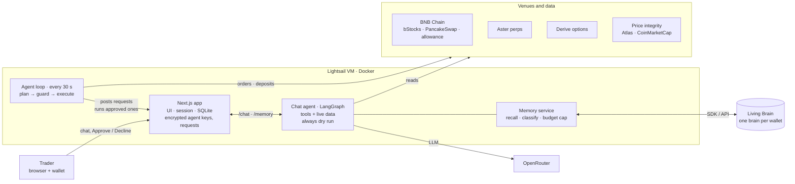
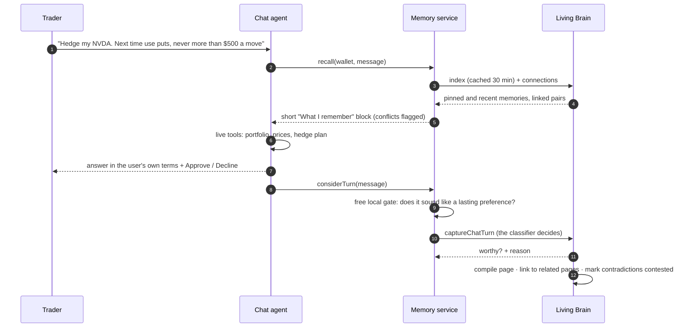
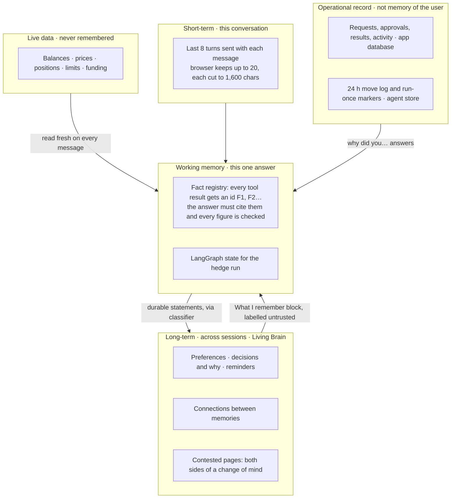

# Pulse Risk · BNB, with Living Brain memory

An AI risk agent for people who hold **tokenised stocks (bStocks) on BNB Chain**. It hedges them with **perps (Aster)** and **options (Derive)**, tops up margin from the BNB wallet, and asks for approval before anything moves money. A chat agent ("Pulse") sits on top.

This repo is the **Living Brain edition**: the chat agent has a long-term memory kept in [Living Brain](https://livingbrain.com), so it remembers how *you* like to hedge, why you said no last time, and what you asked it to remind you of, across sessions.

> **The one rule that keeps it safe:** memory shapes *wording and preferences*. It never supplies balances, prices, limits or positions (those come from live tools only), and a memory can never approve or trigger a trade. Money only moves after the user presses **Approve**.

## Links

| | |
|---|---|
| **Live demo (Living Brain edition)** | [https://brain.54.251.42.51.sslip.io](https://brain.54.251.42.51.sslip.io) |
| **Living Brain** (the memory layer we use) | [livingbrain.com](https://livingbrain.com) · [Docs](https://docs.livingbrain.com/docs/quickstart) · [Build guide](https://docs.livingbrain.com/docs/build) · [TypeScript SDK](https://docs.livingbrain.com/sdk/typescript.md) |
| **Source of this folder** | [plusarx/living-brain](https://github.com/plusarx/living-brain) |
| **Hackathon track** | [BNB Bangkok on HackQuest](https://www.hackquest.io/hackathons/BNB-Bangkok) · ChatAndBuild: Build Memory-Powered Agents with Living Brain |
| **Pitch deck** | [pitch-deck.pdf](https://github.com/plusarx/Pulse-Risk-Agent-Mainnet/blob/main/pitch-deck.pdf) |
| **Master repo** | [plusarx/Pulse-Risk-Agent-Mainnet](https://github.com/plusarx/Pulse-Risk-Agent-Mainnet) (this project next to [bnb-hackathon](https://github.com/plusarx/Pulse-Risk-Agent-Mainnet/tree/main/bnb-hackathon) and [CMC-X-Atlas](https://github.com/plusarx/Pulse-Risk-Agent-Mainnet/tree/main/CMC-X-Atlas)) |

## Architecture



| Part | What it does |
|---|---|
| **App** (`app/`, `components/`, `lib/`) | UI (portfolio, trade, risk, agent keys, **Memory**), wallet sign-in, SQLite for requests and encrypted agent keys. |
| **Chat agent** (`agent/src/chat`) | A tool-using LangGraph agent. Code owns every number; the model only words them. Every figure in an answer is checked against tool results. It can only *propose*: it never executes. |
| **Agent loop** (`agent/src/index.ts`) | Every 30 s per wallet: reads live accounts, plans hedges and top-ups, posts requests, runs the ones the user approved, after re-checking caps, allowance, reserve and the kill switch. |
| **Memory** (`agent/src/memory`) | The Living Brain integration (below). |

## Where Living Brain fits

The chat is a stateless model call. Living Brain turns it into an agent that **remembers, retrieves and connects**:



**What Living Brain does for us (all through the official SDK `@living-brain/sdk`):**

| Living Brain feature | How the agent uses it |
|---|---|
| **Remember**: `captures.captureChatTurn` (worthiness classifier) | A message that sounds like a lasting preference, rule, decision or reminder is sent. The classifier keeps durable knowledge and drops filler, and says *why*. Verified live: "I prefer protective puts… never more than $500 a move" kept; a rambling question declined. |
| **Remember**: `captures.capture` | Explicit "remember that…" notes and a declined request (with the reason), idempotent through `originRef`. |
| **Standing profile**: `workspace.updateProfile` | Each brain gets directives: *surface connections*, *flag contradictions*, and a custom rule to keep only what the user stated and **never** balances, prices, amounts or keys. |
| **Retrieve**: `workspace.index`, `searchPages` | Pinned and recent memories are loaded once per session; a search is used only when the brain is bigger than the index. |
| **Connect**: `workspace.listConnections` | Related memories (for example *"prefers puts for NVDA"* and *"never more than $500 a move"*) are linked with a reason, and the pair is handed to the model so the answer can say how they fit. |
| **Contradictions**: page status `contested` | When a new statement contradicts an old one, Living Brain keeps **both** and marks the page `contested`. The agent is told to name both and ask which is current instead of choosing. Verified live. |
| **Control**: `pin`, `deletePermanently`, `listPages` | The Memory tab lists everything, pins "always keep in mind", deletes one memory, or clears all. |
| **Isolation**: one brain per wallet | The key acts for one subject, so each wallet gets its own brain named from a hash of the wallet. The address is never sent. |

**Verified against the real API** (not just mocks): a stated preference is kept with a reason; filler is declined; a contradicting preference turns the page `contested` (version 2) with both claims kept; the two pages are linked as a *strong* connection with a written reason.

## Memory layers: short-term, working, long-term (and what is not memory)

The agent keeps four different kinds of state. Only one of them is Living Brain, and each has a different job and a different trust level.



| Layer | Lives in | Lasts | Holds | Can it move money? |
|---|---|---|---|---|
| **Short-term** | The chat window and the request the app sends (`history`, last 8 turns used) | One conversation. Cleared by **Clear chat** | What was just said, so "do that for TSLA too" works | No |
| **Working memory** | The chat agent's per-answer state (`Ctx`: fact registry, scenarios, steps) | One answer | The live tool results the answer is built from, each with an id. Every dollar figure and percentage in the reply must appear in them, or the answer is flagged | No |
| **Long-term** | **Living Brain** (one brain per wallet) | Until the user deletes it | Preferences, rules, decisions with their reasons, reminders; the links between them; contested pages when the user changed their mind | **No**: wording and preferences only |
| **Operational record** | The app's SQLite (requests, approvals, activity) and the agent's store (24 h move totals, run-once markers) | Kept by the app | What the agent proposed, what was approved or declined, what ran, caps already used today | Only through Approve and the guard, as before |
| **Live data** | Aster, Derive, BNB Chain, PancakeSwap, price feeds | Read on every message | Balances, prices, positions, limits, funding | Not memory at all: it is never stored or recalled |

**How they combine in one answer.** The agent starts from the short-term turns, adds the long-term block ("you prefer puts; you declined the NVDA put because of the premium"), reads live data for every number, runs the hedging plan, and writes the answer from the facts it can cite. After the answer, a statement that sounds like a lasting preference goes through Living Brain's classifier; if it is kept, it becomes long-term memory for the next session.

**Why the split matters.** Long-term memory is what makes the agent feel like it knows you, but it can be stale or wrong, so it is *advisory*: it picks the instrument and the wording, never a price or a size. Live data wins every disagreement, and the user's Approve is the only way money moves.

## What the user sees

- **Memory tab** in the chat and a **Memory** page in the sidebar: what the agent remembers, pin, delete, **Clear all**, add a note, and a usage meter ("Powered by Living Brain").
- Answers that used memory say **"Used N memories · Living Brain"** and expand to show which ones.
- Plain language in the answer for the rest: *"since you prefer puts…"*, *"last time you declined the NVDA put because of the premium"*, *"you said both… which is current?"*.
- Chat tools: `remember`, `forget_memory`.

## Keeping it cheap and safe

- **Cost.** A saved memory costs about **2 to 2.5 US cents** (measured). Reads are almost free. The agent spends from a hard **estimated cap** (`MEMORY_BUDGET_USD`, default 2.50) and then stops saving and recalling: the chat carries on without memory.
- **Few requests.** A free local gate decides what is worth sending to the classifier; the index is cached 30 minutes; a small brain is ranked locally with no search; there is no background polling; approvals are not saved (they are in Activity), declines are.
- **Never blocks the chat.** Recall has a 1.5 s timeout; no key, no budget or any error means the chat answers without memory.
- **Trust boundary.** Recalled text is labelled as the user's own words, never a source for numbers and never an instruction. Live data and Approve stay in charge.
- **Privacy.** Preferences and decisions only, for a signed-in wallet, with delete and Clear all. No balances, keys or amounts of the user's money.

## Run it locally

```bash
npm install && (cd agent && npm install)
cp .env.example .env.local             # SESSION_SECRET, KEYSTORE_SECRET, AGENT_API_TOKEN (openssl rand -hex 32)
cp agent/.env.example agent/.env       # same AGENT_API_TOKEN, OPENROUTER_API_KEY, LIVING_BRAIN_API_KEY
npm run dev:all                        # app :3100 + chat :3200 + agent loop (dry run by default)
```

`DRY_RUN=false` and `ALLOW_LIVE=yes-i-understand` in `agent/.env` make the agent loop place real orders; the chat service is always dry run. Without `LIVING_BRAIN_API_KEY` the chat behaves exactly as before.

## Demo script (3 to 5 minutes)

1. **Remember.** Tell the chat: *"For NVDA I prefer protective puts over perp shorts, and never more than $500 on one move."* Open **Memory**: the memory appears within about 15 s ("Saving to Living Brain…" first).
2. **Retrieve.** New chat: *"Hedge my NVDA."* The answer starts from the stored preference ("Used 2 memories · Living Brain"), shows the hedge card and the **Approve / Decline** buttons.
3. **Connect.** The answer ties the two memories together (the $500 cap sizes the put).
4. **Change of mind.** *"Actually I now prefer perp shorts, the premium is too high."* Living Brain marks the old preference `contested`; the agent says it sees both and asks which is current.
5. **Control.** Pin one memory, delete one, show the usage meter (cents), then **Clear all**.
6. **Safety line.** Numbers always come from live tools; Approve is the only way money moves.

---

## Run

```bash
npm install
cp .env.example .env.local     # fill SESSION_SECRET, KEYSTORE_SECRET, AGENT_API_TOKEN (openssl rand -hex 32)
npm run dev                    # http://localhost:3100
npm test                       # unit tests
npm run build
```

Node ≥ 22.5 (uses the built-in `node:sqlite`). Data lives in the SQLite file named by `DB_PATH` (gitignored).

## Deploy (Docker, e.g. AWS Lightsail)

`docker-compose.yml` runs four containers: `app` (Next.js), `agent` (tick loop), `agent-chat` (chat API, always a dry run) and `caddy` (HTTPS on 80/443 with automatic Let's Encrypt). Only Caddy is exposed. SQLite data lives in the `app-data` and `agent-data` volumes.

```bash
bash deploy/lightsail-setup.sh                      # once per instance: Docker + 2 GB swap
cp .env.example .env                                # secrets + DOMAIN (+ NEXT_PUBLIC_* RPCs, baked in at build)
cp agent/.env.example agent/.env                    # AGENT_API_TOKEN must equal the app's
docker compose up -d --build
docker compose logs -f app agent                    # https://$DOMAIN/api/health → {"db":"ok","lighterSigner":"ok"}
```

**Lightsail via GitHub Actions (how production runs):** `.github/workflows/docker.yml` builds `ghcr.io/plusarx/bnb-hackathon-app` and `bnb-hackathon-agent` on every push to `main`, then SSHes into the VM, copies `deploy/docker-compose.yml` to `~/pulsarx/`, pulls the `sha-<short>` images and restarts. One-time setup: run `deploy/lightsail-setup.sh` on the VM, put `.env` and `agent.env` in `~/pulsarx/`, and add the repo secrets `LIGHTSAIL_HOST`, `LIGHTSAIL_SSH_KEY` (the .pem contents) and optionally `LIGHTSAIL_USER` (default `ubuntu`) and `LIGHTSAIL_KNOWN_HOSTS`. To deploy by hand instead, run `deploy/push-images.sh`, then on the VM `cd ~/pulsarx && docker compose pull && docker compose up -d`. To pin a build, set `TAG=sha-<short>` in `.env`.

**Price integrity on the VM:** add `ATLAS_API_KEY=<key>` to BOTH `~/pulsarx/.env` (the app reads it for the Risk page) and `~/pulsarx/agent.env` (the agent reads it for hedging and top-ups), then `docker compose up -d`. Without it the Atlas view is skipped and the other price views still run. The on/off switch is on the Risk page.

HTTPS is required: in production the session cookie is `Secure`. If you have no domain, use `DOMAIN=<static-ip>.sslip.io`. Back up the volumes, because `app-data` holds the encrypted agent keys and losing `KEYSTORE_SECRET` makes them unreadable.

## What's where

| Page | What it does |
|---|---|
| `/` Portfolio | Live total across BSC wallet, bStocks, Aster perps and Derive options (polls about every 3–4 s, plus instant refresh on USDC/USDT transfers) |
| `/trade/spot/[symbol]` | bStock spot: chart, book and trades (Binance reference data), swap ticket (PancakeSwap V3, quoted across all fee tiers, exact approvals) |
| `/trade/perps` | Aster perps (BNB Chain): markets, chart, book, long/short ticket with per-market leverage, signed by the agent key, positions, open orders |
| `/trade/options` | Derive options chain (ETH, BTC, SOL, HYPE + RWA: NVDA, US500, US100, gold, oil), ticket signed by the session key |
| `/funding` | BNB → Aster (USDT deposited on BNB Chain, no bridge), BNB ↔ Ethereum (Relay), Ethereum → Derive direct deposits, testnet faucets |
| `/agents` | Register the Aster agent key and the Derive session key (MetaMask signs; the key is created and stored encrypted server-side) |
| `/automation` (Risk management) | KPI strip (health, utilization, liquidation distance), auto margin rebalancing (per-account rules with zone bars, ported from the original terminal), stress test, hedge legs, funding source + agent allowance, activity |
| `/collateral` | All 26 bStocks, holdings, haircut collateral value |
| `/memory` | What the chat agent remembers about you (Living Brain): list, pin, delete, Clear all, usage |
| `/docs` | Agent integration guide plus the endpoint references for Derive, Relay and bStocks |

The **network toggle** (sidebar) switches the perps and options venues between mainnet and testnet where they exist. bStocks only exist on BSC mainnet, and Relay has no testnet routes.

## Security notes
- Identity comes from a signed-in session cookie (wallet signature with a single-use nonce), never from request bodies.
- Agent keys are AES-256-GCM encrypted with `KEYSTORE_SECRET`. Each key is bound by AAD to its wallet, venue and network.
- Derive session keys never request `admin`, `set_session_key`, `transfer:all` or `transfer:different_owner_subaccount`. The scopes are re-read after registration and refused if they are wrong.
- Relay quotes are decoded and pinned (router, token, amount, depositor) before MetaMask sees them. ERC-20 approvals are for exact amounts.
- Order endpoints require an `Idempotency-Key`.

## Vendored
`vendor/lighter/lighter-signer.wasm` is built from `elliottech/lighter-go` **v1.0.13** (commit `e8687faa`) with `GOOS=js GOARCH=wasm go build -trimpath -ldflags="-s -w" ./wasm/` on Go 1.26.0. `wasm_exec.js` comes from the same Go toolchain. v1.0.13 is required: earlier versions reject market ids above 254.
