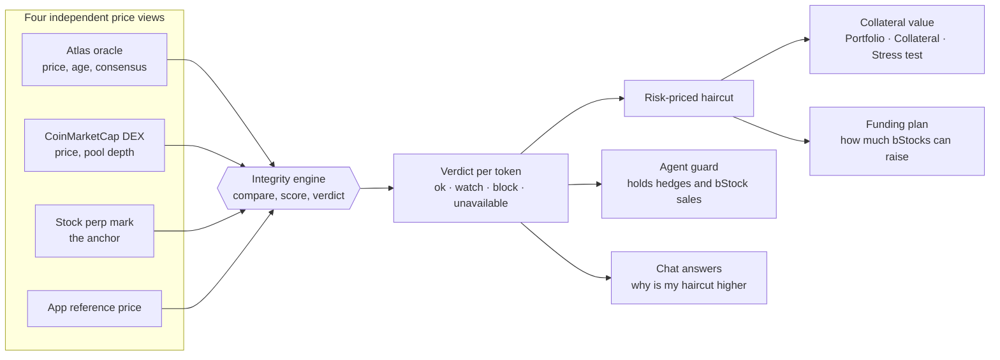
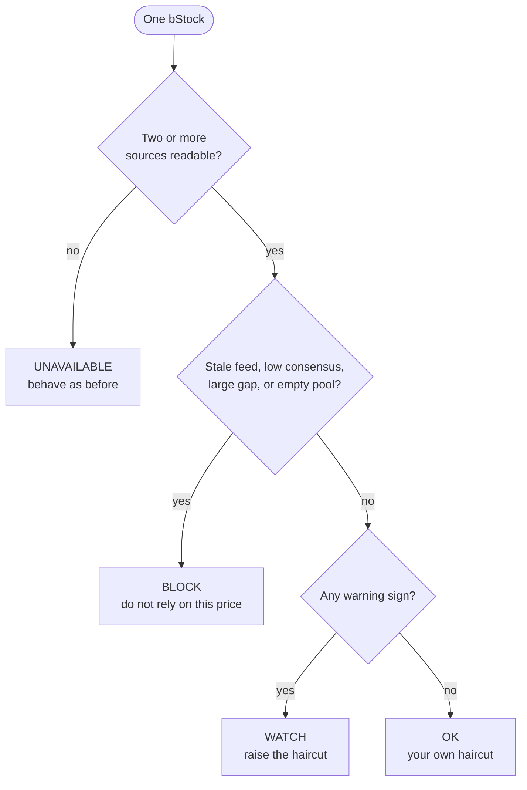

<p align="center"></p>

# Pulse Risk · Price Integrity

**[▶ Watch the demo video](https://drive.google.com/file/d/17EDyvDn2Gmr7KKx7LkhZsuqBNJTx7zs5/view?usp=sharing)**

 **Currently live on mainnet.**

**Can you trust the price your collateral is valued at? Pulse Risk checks, before it acts.**

Pulse Risk is a risk desk for tokenized stocks (bStocks) on BNB Chain. This README is about one feature: a
**price-integrity and risk-pricing layer** that cross-checks every bStock price against independent sources, prices the
risk into the collateral haircut, and stops the agent from acting on a price it cannot trust.

---

## The use case

An agent that manages margin for you does two dangerous things with bStock prices:

1. **It counts your bStocks as collateral.** A price that is too high overstates how safe you are.
2. **It sells your bStocks to top up margin, and hedges them with perps.** A stale or wrong price means selling into a pool
   with no liquidity, or hedging a position that is not worth what the screen says.

A single oracle can be stale, degraded or wrong. A token with a familiar ticker can be a fake with a $7k pool. The cost of
trusting a bad price is a liquidation or a bad forced sale.

> **Pulse Risk never trusts one number.** It compares four sources, gives every token a verdict, charges the risk to the
> haircut, and refuses to act on a price that fails.

| Without the layer | With the layer |
|---|---|
| One flat 30% haircut on everything | A haircut priced per token from live evidence |
| A stale feed is used as if it were fresh | A stale feed blocks the token |
| A thin pool is valued like a deep one | Thin pools raise the haircut or block the token |
| The agent sells whatever you allowed | The agent holds off on a token whose price fails |

---

## Architecture



The engine is one shared module used by both the web app (the Risk page and collateral numbers) and the agent (its
decisions), so what you see is exactly what the agent acts on.

---

## How the price is checked

For each bStock the engine reads four views of the same stock.

| Source | What it gives | Why it is there |
|---|---|---|
| **Atlas oracle** | On-chain feed price, age in seconds, consensus score and status (healthy or degraded) | The oracle view, and its own health signal |
| **CoinMarketCap DEX** | DEX price and pool liquidity, looked up by **token contract address** | A market view, and proof the token can be sold. Address lookup means a look-alike ticker cannot pass as the real token |
| **Stock perp mark** | Mark price of the underlying stock's perpetual | The **anchor**: it follows the real stock, not the token |
| **App reference price** | The price the app already uses | A fourth opinion |

Atlas feeds are confirmed for **NVDAB, MSTRB, SPYB, QQQB and TSLAB**. Other tokens are checked on the three remaining
views.

### Verdicts



| Verdict | Triggers | Effect |
|---|---|---|
| **OK** | Sources agree | Collateral counts at your own haircut |
| **WATCH** | Feed marked degraded or consensus under 0.85, a gap of 1.5% or more to the anchor, or a pool under $1M | Haircut is raised, never lowered |
| **BLOCK** | Feed older than 180 s, consensus under 0.70, a gap of 4% or more to the anchor, or a pool under $100k | Agent will not act on the token. Haircut shows 90% |
| **UNAVAILABLE** | Fewer than two sources could be read | Nothing changes. It never blocks because of our own outage |

---

## Risk pricing: the dynamic haircut

The haircut is the discount applied to a bStock before it counts as collateral. You set the base (30% by default). The
layer **adds** points for each risk it finds, up to a cap of 90%. It can never go below your base.

| Risk found | Points added |
|---|---|
| Atlas feed degraded, or consensus under 0.85 | +3 |
| Gap to the anchor of 1.5% or more | +2 points for every 1% of gap, up to +10 |
| Pool liquidity $500k to $1M | +2 |
| Pool liquidity $250k to $500k | +4 |
| Pool liquidity $100k to $250k | +6 |

```
collateral value = quantity × price × (1 − haircut)
```

**Worked example.** MSTRB with a degraded Atlas feed and a $234k pool: 30% base + 3 (degraded) + 6 (pool under $250k)
= **39%** haircut. $10,000 of NVDAB counts as $7,000 at 30%, and $6,700 once the layer adds 3 points.

### An example reading (Nov 26, live data)

| Token | Atlas | CoinMarketCap DEX | Perp | Biggest gap | Verdict | Haircut | Why |
|---|---|---|---|---|---|---|---|
| QQQB | 636.34 | 635.30 | 636.65 | 0.21% | OK | 30% | Sources agree |
| NVDAB | 150.40 | 149.38 | 150.23 | 0.56% | WATCH | 33% | Atlas marks the feed degraded (0.89) |
| SPYB | 720.91 | 719.62 | 720.81 | 0.16% | WATCH | 33% | Atlas marks the feed degraded (0.81) |
| GMEB | no feed | 26.77 | 26.79 | 0.11% | WATCH | 34% | Pool of $462,341 is limited |

Address lookup matters: a search for TSLAB on the DEX also returns a look-alike token with a $7,083 pool, against $1.85M
for the real one. The look-alike would be blocked on liquidity alone.

---

## Where it is enforced

| Where | What changes |
|---|---|
| **Collateral and Portfolio** | Every bStock is valued with its own haircut, shown as "+N pts" with the reason |
| **Stress test** | The shock uses the integrity-adjusted haircut |
| **Funding panel** | How much the agent can raise by selling bStocks uses the per-token haircut |
| **Agent: margin top-ups** | A bStock sale is put on hold if its price is blocked. Sale amounts are sized with the per-token haircut |
| **Agent: hedges** | A new hedge against a blocked token is put on hold. A reduce-only close is never blocked |
| **Chat** | Ask "can I trust the price of NVDAB?" or "why is my haircut higher?" and it answers from the live data |

The **Price integrity** panel on the Risk page shows the whole table (all four prices, the gap, the verdict, the haircut
and the reason) with an **Enabled** switch.

---

## Safe by design

- **Fails open on our own outage.** If fewer than two sources answer, the token reads "unavailable" and nothing changes.
- **One switch.** Off means the old flat haircut, no checks, nothing blocked. It is on by default.
- **Only ever adds.** The dynamic haircut cannot fall below the haircut you set.
- **Never blocks an exit.** Reduce-only closes do not depend on the price check.
- **Bounded and cached.** Every outbound call has a timeout, DEX data is cached for a minute and the full result for 15 s.

---

## CoinMarketCap in chat

Beyond prices, the chat agent can read live CoinMarketCap data through its MCP server: the next 7 days of scheduled
events for a US stock (earnings and the like), a whole-crypto-market overview, and a derivatives overview.

---

## Run it

Requires Node 22.5 or newer and any EVM wallet.

```bash
npm install
cp .env.example .env.local          # fill the secrets
cd agent && npm install && cp .env.example .env && cd ..   # the agent has its own settings file
npm run dev:all                     # app (3100) + agent chat (3200) + agent loop
```

Then open http://localhost:3100, connect, and go to **Risk management** to see the **Price integrity** panel.

| Variable | Where | Needed | Purpose |
|---|---|---|---|
| `ATLAS_API_KEY` | app and agent | for the Atlas view | Atlas pull API key |
| `CMC_API_KEY` | agent | for the CoinMarketCap tools | CoinMarketCap MCP key for the stock-event and market tools |
| `SESSION_SECRET`, `KEYSTORE_SECRET`, `AGENT_API_TOKEN` | app and agent | yes | Generate each with `openssl rand -hex 32` |

```bash
npm test                              # app, includes the integrity tests
cd agent && npm test                  # agent
```

More: [integration write-up](INTEGRATION-WRITEUP.md) · [demo script](docs/DEMO.md)
