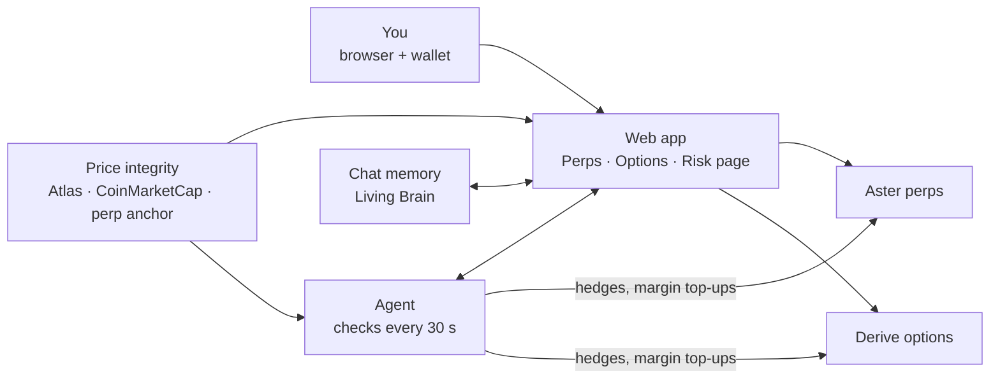

# Pulse Risk

**A risk desk for tokenized stocks on BNB Chain, perpetuals on Aster and options on Derive, with an agent that watches
your margin and checks every price before it acts.**

Pulse Risk shows one portfolio across your BNB wallet, your perps account and your options account. An agent keeps
margin healthy and places hedges inside limits you set. It can never withdraw your money, and in its default mode it does
nothing until you press Approve.

---

## Start here

| | |
|---|---|
| **See the idea** | [Pitch deck](pitch-deck.pdf) |
| **Why the prices can be trusted** | [CMC-X-Atlas](CMC-X-Atlas/) |
| **How trading and the agent work** | [bnb-hackathon](bnb-hackathon/) |
| **How the agent remembers you (long-term memory)** | [ChatAndBuild-X-Living-Brain](ChatAndBuild-X-Living-Brain/) |
| **Try the Living Brain edition live** | [https://brain.54.251.42.51.sslip.io](https://brain.54.251.42.51.sslip.io) |
| **About Living Brain** | [livingbrain.com](https://livingbrain.com) · [Docs](https://docs.livingbrain.com/docs/quickstart) · [Source repo](https://github.com/plusarx/living-brain) |

---

## What is in each folder

| Folder | What it covers | Read this for |
|---|---|---|
| **[CMC-X-Atlas](CMC-X-Atlas/)** | The **price-integrity and risk-pricing layer**: four independent price sources (Atlas oracle, CoinMarketCap DEX data, the stock's perp, the app's own price), a verdict per token, a risk-priced collateral haircut, and the rules that stop the agent from acting on a bad price | The use case, the thresholds, the haircut math and where it is enforced. [README](CMC-X-Atlas/README.md) · [Demo script](CMC-X-Atlas/docs/DEMO.md) |
| **[bnb-hackathon](bnb-hackathon/)** | **Perps on Aster, options on Derive and the agent**: the trading tickets, leverage, funding from your BNB wallet, margin rules, hedges, the two modes, the limits and the chat | How each venue works and how the agent decides and acts. [README](bnb-hackathon/README.md) · [Agent guide](bnb-hackathon/docs/AGENT.md) · [Build guide](bnb-hackathon/docs/AGENT_BUILD.md) · [Aster notes](bnb-hackathon/docs/endpoints/aster.md) |
| **[ChatAndBuild-X-Living-Brain](ChatAndBuild-X-Living-Brain/)** | **Long-term memory with Living Brain**: the chat agent remembers your hedging preferences, your decisions and why, and your reminders across sessions, connects related memories, and keeps both sides when you change your mind. Memory only shapes wording and preferences: numbers come from live data and money moves only on Approve | How the agent gets to know you: the remember, retrieve and connect flow, the memory layers, the Memory tab, and the cost controls |

Each folder is a complete, runnable copy of the application. The three READMEs tell the same project from three angles:
one around price integrity, one around trading and the agent, and one around the agent's long-term memory (Living Brain).

---

## Where things live

| Part | Network |
|---|---|
| **bStocks** (tokenized stocks) | BNB Chain |
| **Perps** (Aster) | Aster chain |
| **Options** (Derive) | Ethereum |

---

## How the pieces fit



The agent acts only through the app, only inside your limits, and only on prices that pass the integrity check. The chat remembers your preferences in Living Brain, but memory never supplies a number and never approves anything.

---

## Key facts

- **Perps:** Aster (Aster chain), USDT margin, leverage per order, funded from your BNB wallet with no bridge.
- **Options:** Derive (Ethereum), with orders signed by a limited session key.
- **Agent:** margin top-ups, releases and hedges. Modes: **Ask me first** (default) and **Autonomous**.
- **Limits in code:** kill switch, per-trade and per-day caps, leverage cap, daily loss cap, off-BNB cap, autonomy expiry.
- **Memory:** the chat agent keeps your preferences, decisions and reminders in Living Brain (about 2 cents per saved memory, with a hard budget cap), connects related memories and flags contradictions. Memory is advisory only.
- **Safety:** the Aster agent key cannot withdraw; every order carries an idempotency key; keys are encrypted at rest.

---

## Run it

Requires Node 22.5 or newer and any EVM wallet. Pick any folder, then:

```bash
cd bnb-hackathon                    # or CMC-X-Atlas, or ChatAndBuild-X-Living-Brain
npm install
cp .env.example .env.local          # fill the secrets
cd agent && npm install && cp .env.example .env && cd ..
npm run dev:all                     # app (3100) + chat (3200) + agent loop
```

Open http://localhost:3100. Setup details, settings and tests are in each folder's README.
