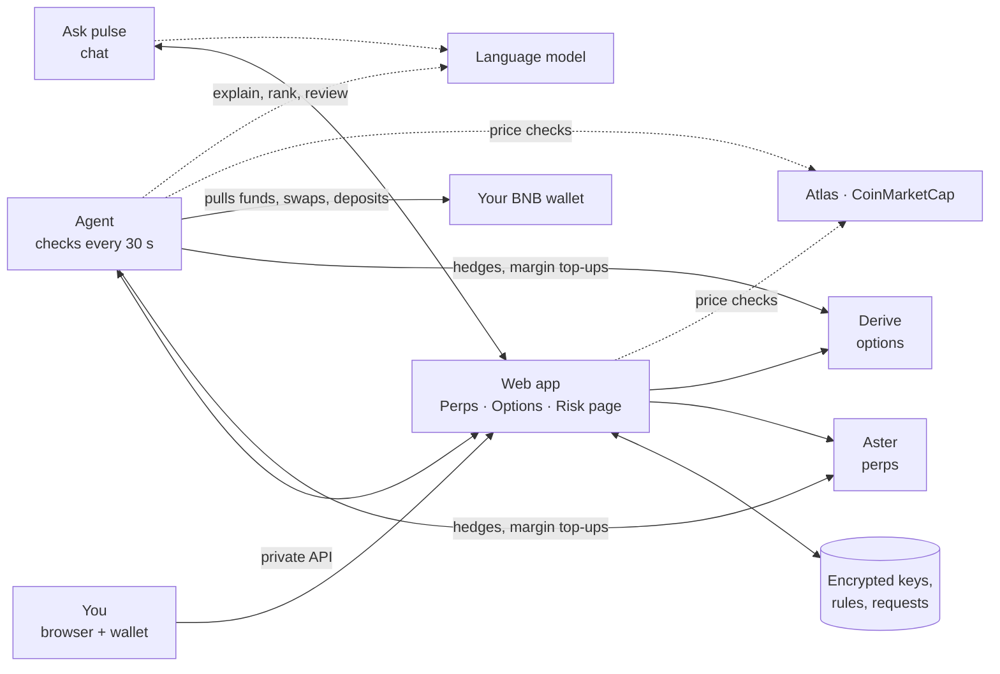
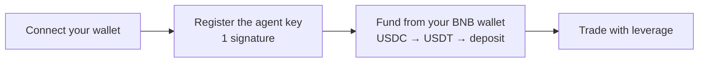
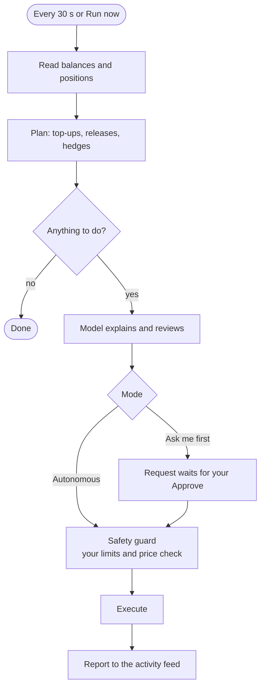

<p align="center"></p>

# Pulse Risk · Perps, Options and the Agent

**Trade perpetuals and options from one screen, and let an agent watch your margin and hedge for you, inside limits you set.**

Perps run on **Aster** (Aster chain, USDT margin). Options run on **Derive** (funded through Ethereum). An agent checks your accounts every 30
seconds, tops up margin from your BNB wallet before an account runs short, and places hedges. It cannot move money out,
and in the default mode it does nothing until you press Approve.

---

## What you get

| Area | What it does |
|---|---|
| **Perps (Aster)** | Long and short market orders on stock and crypto perpetuals, with leverage per order |
| **Options (Derive)** | A live options chain with orders signed by a limited session key |
| **Agent** | Keeps margin healthy, hedges your holdings, asks before it acts |
| **Ask pulse (chat)** | Answers questions about your accounts and markets, and proposes trades and moves as requests you approve |
| **Risk page** | Account health, margin rules, hedge legs, limits, stress test and the activity feed |

---

## Where things live

| Part | Network |
|---|---|
| **bStocks** (tokenized stocks) | BNB Chain |
| **Perps** (Aster) | Aster chain |
| **Options** (Derive) | Funded through Ethereum |

---

## Architecture



The browser never talks to the agent directly. The chat can only create requests; the agent loop is the only part that
acts, and only through the app.

---

## Perps on Aster

- **Markets.** Stock and crypto perpetuals, USDT-margined, with a chart, order book and recent trades.
- **Orders.** Long or short market orders, with a reduce-only switch for closing a position.
- **Leverage.** Set per order with a slider and quick picks, up to each market's own maximum.
- **Sizing.** Enter the size in tokens, or the **margin in dollars**. The smallest order is $5, so $1 of margin at 5x clears it.
- **Positions and orders.** Entry, mark, leverage and liquidation price for each position, plus open orders.
- **Activity.** Past orders and deposits, each deposit linked to its transaction.
- **Funding from your BNB wallet, no bridge.** Your USDC is swapped to USDT and deposited into Aster in one flow. The
  smallest deposit is about $6.
- **A limited agent key.** One wallet signature registers a key that can place and cancel perp orders and read the account.
  It cannot trade spot and **cannot withdraw**. Money leaves Aster only with your own signature.



---

## Options on Derive

- **Options chain.** ETH, BTC, SOL and HYPE, plus stock and index underlyings: NVDA, US500, US100, gold and WTI oil.
- **Orders.** Signed by a session key that can trade and move margin between your own subaccounts. It never gets admin
  rights and cannot send funds to anyone else.
- **Subaccounts.** One subaccount per risk universe (for example the stock universe), so each market group has its own margin.
- **Funding.** Margin reaches Derive through Ethereum, either by bridging from BNB Chain or by depositing from your own
  Ethereum wallet. Registering the session key takes three signatures.
- **Withdrawals.** Back to your own Ethereum wallet.

---

## The agent

Every 30 seconds, or when you press **Run now**, the agent looks at each wallet and decides whether anything needs to happen.



The plan and the guard are plain code. The language model only explains, ranks and reviews, and it cannot loosen a limit.

### What it does

| Job | How it works |
|---|---|
| **Margin top-ups** | You set a rule per account: top up when margin used passes a trigger (or account value falls under one), back to a target. The money comes from your BNB wallet: USDC first, then USDT, then, only if you allow it, bStocks sold in the order you choose |
| **Releases** | The same rules can release surplus margin after it stays high for a set time. On Derive the agent withdraws it; on Aster it cannot, so it leaves you a note and you withdraw in the app |
| **Hedges** | For each holding you list, a hedge leg shorts the matching perp or holds a protective Derive put. Sized as a ratio of the holding, or as the smallest hedge that keeps your modelled loss under your loss limit |
| **News and events** | Optional news flags and a calendar of scheduled events feed the analysis. They are advisory and never change a position |

### Two modes

- **Ask me first** (default). The agent posts a request with what it will do and why. Nothing happens until you press Approve. Requests expire after 30 minutes.
- **Autonomous.** The agent acts inside your limits and reports in the activity feed. Permission can expire automatically.

### Limits, enforced in code

| Limit | Meaning |
|---|---|
| Kill switch | Halts every new order and transfer |
| Per-trade and per-day caps | Largest single trade and total traded per day |
| Leverage cap | The agent never exceeds it |
| Daily loss cap | Autonomous action stops once reached |
| Off-BNB cap | Most idle money parked on Aster and Derive |
| Autonomy expiry | Autonomous permission lapses at a time you choose |

### Ask pulse (chat)

Ask about your portfolio, a market, a position's liquidation distance, an option's price, or a what-if. It can propose a
trade (with leverage if you ask), a margin move, a funding move or enabling a Derive subaccount. Each proposal is a
**request with Approve and Decline**. The chat itself never places anything.

---

## How Atlas and CoinMarketCap are used

The agent sometimes sells bStocks you hold to top up margin, and it values them as collateral. Before it relies on a
bStock price it checks it against **Atlas** (the oracle feed, with its age and consensus score), **CoinMarketCap** DEX
data (price and pool depth) and the stock's own perp price. A token whose price fails is put on hold, and the haircut on
a doubtful one is raised. In chat, CoinMarketCap also supplies the **stock event calendar** and market overviews.

---

## Run it

Requires Node 22.5 or newer and any EVM wallet.

```bash
npm install
cp .env.example .env.local          # fill the secrets
cd agent && npm install && cp .env.example .env && cd ..   # the agent has its own settings file
npm run dev:all                     # app (3100) + chat (3200) + agent loop
```

Open http://localhost:3100, connect, go to **Agent keys** and register the **Perps** key, then fund the account from
the Funding page. The agent starts as a **dry run**: it sends nothing until you set `DRY_RUN=false` **and**
`ALLOW_LIVE=yes-i-understand` in `agent/.env`.

| Variable | Where | Needed | Purpose |
|---|---|---|---|
| `SESSION_SECRET`, `KEYSTORE_SECRET`, `AGENT_API_TOKEN` | app and agent | yes | Generate each with `openssl rand -hex 32`. `AGENT_API_TOKEN` must match in both. Never change `KEYSTORE_SECRET` after launch |
| `AGENT_BSC_PRIVATE_KEY` | agent | for live mode | The agent's own gas wallet on BNB Chain (about 0.002 BNB). Never your main wallet |
| `OPENROUTER_API_KEY` | agent | for chat and analysis | The language model |
| `RELAY_API_KEY` | app and agent | for bridging to Derive | Bridge API key |
| `ATLAS_API_KEY` | app and agent | for the price checks | Atlas oracle key |
| `CMC_API_KEY` | agent | for the chat's CoinMarketCap data | CoinMarketCap key for stock events and market data |

```bash
npm test                    # app
cd agent && npm test        # agent
```

---

## Safety

- Identity comes from a signed-in session (a wallet signature with a single-use nonce), never from a request body.
- Agent keys are encrypted at rest and bound to your wallet, venue and network.
- The Aster agent key cannot withdraw. The Derive session key never gets admin rights or transfers to other owners.
- Order endpoints require an `Idempotency-Key`, so a retry cannot place an order twice.

---

Guides: [Agent integration](docs/AGENT.md) · [Agent build](docs/AGENT_BUILD.md) · [Aster notes](docs/endpoints/aster.md) · [Derive notes](docs/endpoints/derive.md) · [Bridge notes](docs/endpoints/relay.md)
